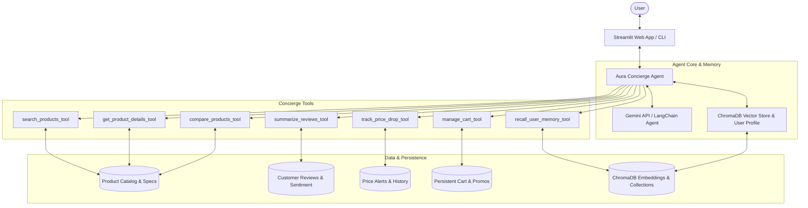

# 🛍️ Hyderabiz Wholesale — AI-Powered B2B Food Commerce Platform

[](https://hyderabiz-wholesale-ai-commerce.vercel.app/)

An advanced, memory-augmented B2B food commerce and wholesale platform designed specifically for cafes, bakeries, sweet shops, and grocers across Hyderabad.
---

## 🌟 Key Features

- **Autonomous Agentic Workflows (LangChain + Gemini)**:
  - Autonomous multi-step tool execution loop for searching products, retrieving specs, summarizing reviews, comparing items, tracking prices, and managing the cart.
  - Dual-mode execution: seamlessly switches between the live **Gemini API** (`gemini-2.5-flash`, `gemini-1.5-pro`) and an **Offline Autonomous Concierge** engine for zero-friction local testing.

- **Conversational & Semantic Memory (ChromaDB)**:
  - **Episodic Vector Memory**: Indexes past conversation turns and user statements into ChromaDB, allowing semantic retrieval of past recommendations and discussions.
  - **Product Vector Catalog**: Semantic vector search enabling conceptual queries like *"comfortable shoes for 12-hour hospital shifts"* or *"travel gadgets for long flights"*.
  - **Long-Term User Profile**: Tracks brand affinities, sizing (e.g., shoe size), hard budget ceilings, and lifestyle traits (e.g., runner, frequent flyer, eco-friendly) across sessions.

- **Customer Review Intelligence & Sentiment Synthesis**:
  - Automatically mines verified customer reviews.
  - Highlights top recurring praises, real-world criticisms (e.g., sizing caveats, battery life quirks), and concierge buying advice.

- **Dynamic Price Drop Monitoring & Alerts**:
  - Users can set price-drop alerts with target thresholds.
  - Real-time market price-drop simulator to test flash sales and observe triggered notifications.

- **Shopping Cart & Financial Breakdown**:
  - Add/remove items, calculate subtotal, estimated shipping, and sales tax.
  - Apply promotional coupons (e.g. `WELCOME10`, `CONCIERGE20`).

- **Triple Interactive Interfaces**:
  - **Modern Interactive Web App (`index.html`)**: Fully-featured, responsive B2B wholesale platform featuring authentic high-definition photography, an intelligent **Hyderabiz AI Sourcing Concierge**, real-time Reseller Profit & Margin Calculator, Product Comparison Matrix, 1-click AI Combo Bundles, Hyderabad delivery tracker, and GST Tax Invoice generator.
  - **Streamlit Web UI (`app.py`)**: Glassmorphism design with multi-tab layout (Chat, Catalog Explorer, Price Watchlist, ChromaDB Memory Inspector, Cart).
  - **Terminal CLI (`cli.py`)**: Fast interactive REPL for command-line use.

---

## 🏗️ Architecture Overview



---

## 📂 Project Structure

```
Gen AI project/
├── .env.example              # Environment variables template
├── requirements.txt          # Python dependencies
├── README.md                 # Project documentation
├── app.py                    # Streamlit web application
├── cli.py                    # Interactive command-line interface
├── src/
│   ├── __init__.py
│   ├── config.py             # Environment & configuration settings
│   ├── catalog.py            # Multi-category product catalog with price history
│   ├── memory.py             # ChromaDB vector store & user profile manager
│   ├── tracker.py            # Price drop tracking & flash sale simulation
│   ├── cart.py               # Shopping cart & checkout calculations
│   ├── tools.py              # LangChain tool implementations
│   └── agent.py              # Autonomous concierge agent with LangChain & Gemini
└── tests/
    ├── __init__.py
    └── test_agent.py         # Pytest test suite covering all modules
```

---

## 🚀 Quickstart Guide

### 1. Prerequisites
- Python 3.10 to 3.14
- (Optional) A Google Gemini API Key from [Google AI Studio](https://aistudio.google.com/)

### 2. Install Dependencies
```powershell
python -m pip install -r requirements.txt
```

### 3. Configure API Key
Create a `.env` file in the project root:
```env
GEMINI_API_KEY=your_actual_gemini_api_key_here
GEMINI_MODEL=gemini-2.5-flash
```
*(Note: If you run without an API key, the agent operates in Autonomous Concierge Mode using the ChromaDB vector database and internal heuristics).*

### 4. Launch the Interactive Website (`index.html`)
You can open `index.html` directly in your favorite browser, or serve it locally:
```powershell
python -m http.server 8000
```
Then visit `http://localhost:8000` in your web browser.

### 5. Deploy the Interactive Website to Vercel
The static wholesale website is configured for Vercel and can be deployed from the repository root:

```powershell
npx vercel
```

For a production deployment:

```powershell
npx vercel --prod
```

The Gemini API key is entered by each browser user and stored only in that browser's local storage. Do not add a real API key to `.env.example`, source control, or client-side code. The Streamlit app and Python agent require a Python host and are not part of this static Vercel deployment.

### 6. Launch the Streamlit Web App (`app.py`)
```powershell
python -m streamlit run app.py
```
Open your browser at `http://localhost:8501`.

### 7. Launch the Command-Line Interface (CLI)
```powershell
python cli.py
```

### 8. Run the Test Suite
```powershell
python -m pytest tests/test_agent.py -v
```

---

## 💬 Sample Prompts to Try

- **Product Discovery**: *"Find me lightweight road running shoes under $130 with great cushioning."*
- **Head-to-Head Comparison**: *"Compare Sony WH-1000XM5 and Bose QuietComfort Ultra."*
- **Customer Review Mining**: *"What do verified buyers say about the Dyson V12 vacuum cleaner? Are there any common complaints?"*
- **Price Drop Tracking**: *"Set an alert for Apple MacBook Air 15-inch when the price drops to $1250."*
- **Conversational Memory**: *"What do you remember about my brand preferences and sizing?"*
- **Cart & Checkout**: *"Add PROD-101 to my cart and apply coupon WELCOME10."*
